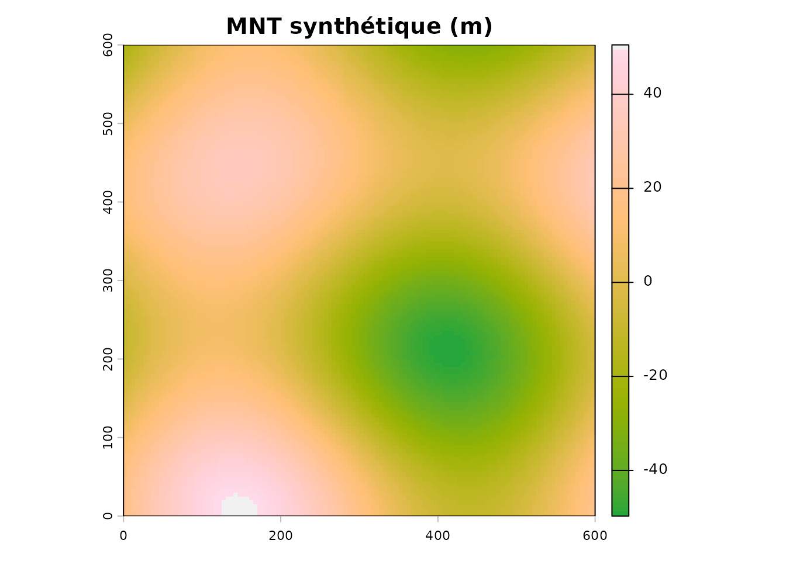
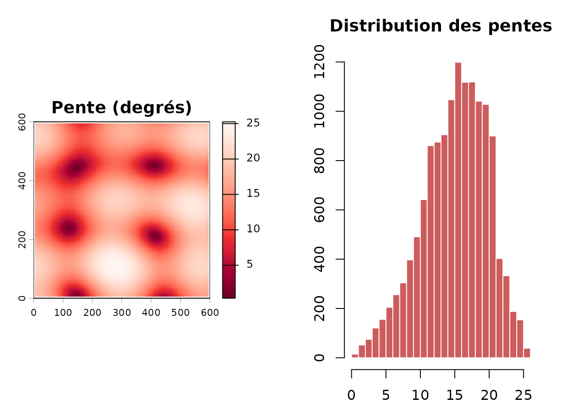
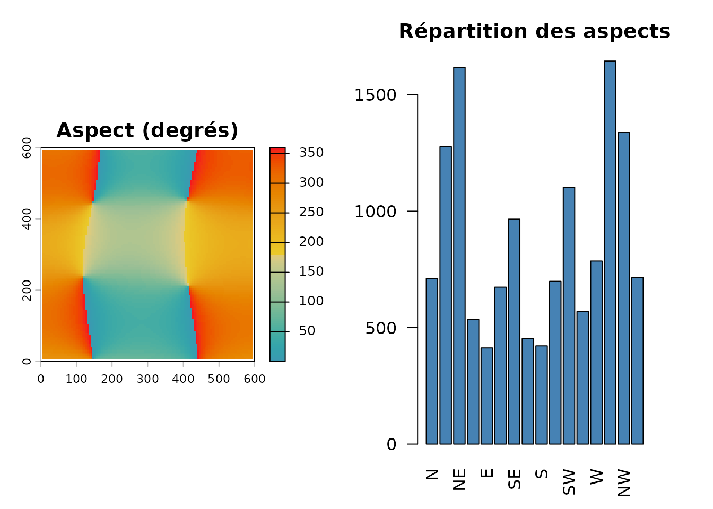
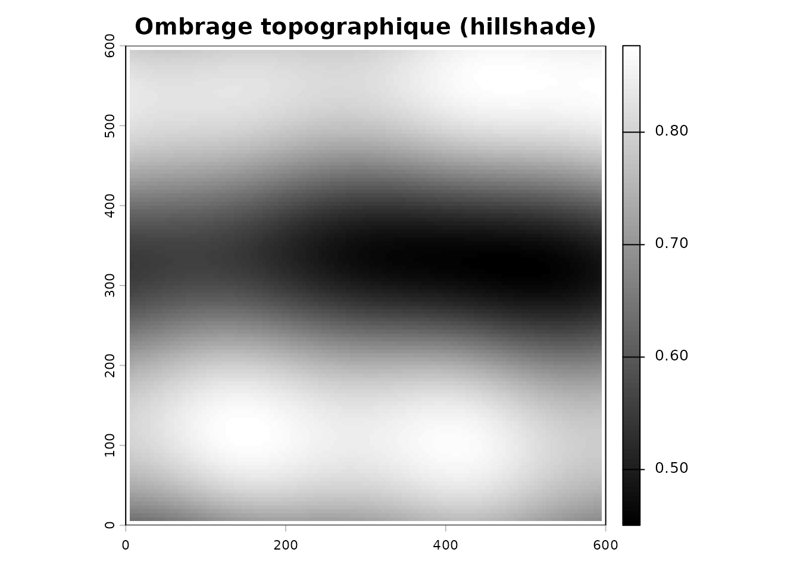
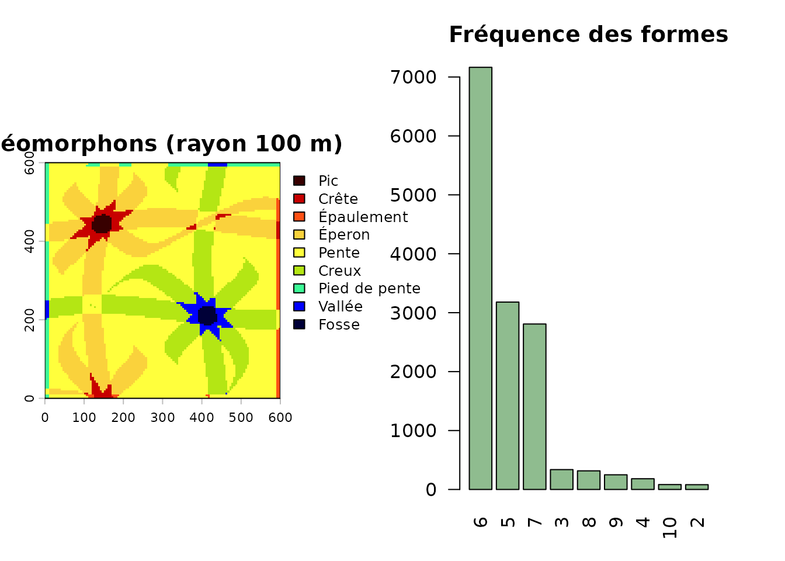
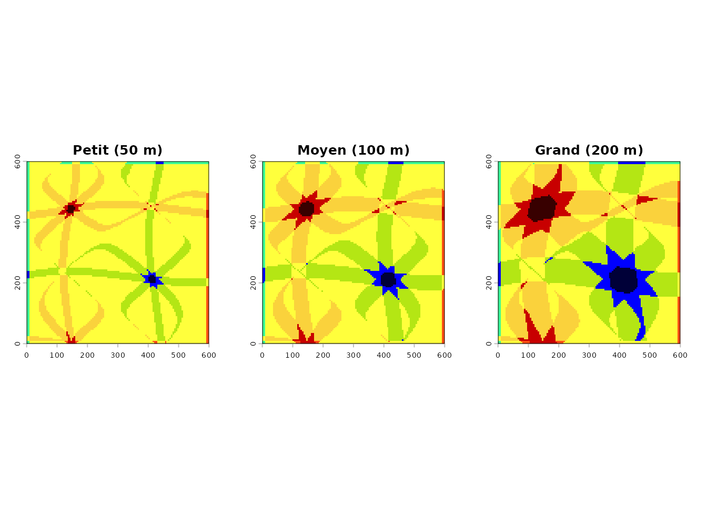

# Démarrage : covariables terrain

``` r

library(covariablechamps)
library(sf)
library(terra)
library(ggplot2)
```

## Objectif

Ce guide montre comment dériver les covariables de relief — **pente**,
**aspect**, **ombrage topographique (hillshade)** et **géomorphons** — à
partir d’un modèle numérique de terrain (MNT).

Pour rester reproductible, tout est calculé sur un **MNT synthétique**.
La dernière section montre le même flux à partir de données LiDAR
réelles.

## Un MNT d’exemple

On fabrique une colline douce de 600 m × 600 m (résolution 5 m) :

``` r

set.seed(1)
mnt <- terra::rast(nrows = 120, ncols = 120,
                   xmin = 0, xmax = 600, ymin = 0, ymax = 600,
                   crs = "EPSG:32618")
xy <- terra::xyFromCell(mnt, 1:terra::ncell(mnt))
terra::values(mnt) <- 25 * sin(xy[, 1] / 90) +
  18 * cos(xy[, 2] / 70) +
  8 * sin((xy[, 1] + xy[, 2]) / 120)
names(mnt) <- "elevation"

terra::plot(mnt, col = hcl.colors(100, "Terrain"), main = "MNT synthétique (m)")
```



## Pente

``` r

pente <- calculer_pente(mnt)

par(mfrow = c(1, 2), mar = c(3, 3, 3, 3))
terra::plot(pente, col = hcl.colors(100, "Reds"),
            main = "Pente (degrés)")
hist(terra::values(pente), breaks = 30, col = "indianred",
     border = "white", main = "Distribution des pentes",
     xlab = "Pente (degrés)")
```



## Aspect

L’aspect indique la direction de la pente (0° = Nord, 90° = Est, 180° =
Sud, 270° = Ouest). Les zones plates ressortent en `NA`.

``` r

aspect <- calculer_aspect(mnt)

par(mfrow = c(1, 2), mar = c(3, 3, 3, 3))
terra::plot(aspect, col = hcl.colors(100, "Zissou"),
            main = "Aspect (degrés)")
# Rose des orientations
a <- terra::values(aspect); a <- a[!is.na(a)]
rose <- hist(a, breaks = seq(0, 360, by = 22.5), plot = FALSE)
barplot(rose$counts, names.arg = c("N", "NNE", "NE", "ENE", "E", "ESE", "SE",
                                   "SSE", "S", "SSW", "SW", "WSW", "W", "WNW",
                                   "NW", "NNW"),
        col = "steelblue", las = 2, main = "Répartition des aspects",
        ylab = "Nombre de cellules")
```



## Hillshade

Le hillshade combine pente et aspect pour un rendu 3D du relief.

``` r

hs <- terra::shade(slope = pente * pi / 180, aspect = aspect * pi / 180)
terra::plot(hs, col = grey(0:100 / 100), main = "Ombrage topographique (hillshade)")
```



## Géomorphons

Les géomorphons classent 10 formes de terrain (crêtes, vallées,
pentes…). Le paramètre `search_radius` fixe l’échelle d’analyse (en
mètres).

``` r

geom <- calculer_geomorphons(mnt, search_radius = 100, flatness_threshold = 1)

par(mfrow = c(1, 2), mar = c(3, 3, 3, 3))
terra::plot(geom, main = "Géomorphons (rayon 100 m)")
barplot(sort(table(terra::values(geom)), decreasing = TRUE),
        col = "darkseagreen", las = 2, main = "Fréquence des formes",
        ylab = "Nombre de cellules")
```



Si `rgeomorphon` n’est pas installé, installez-le avec
`remotes::install_github("brownag/rgeomorphon")`.

### Échelles multiples

``` r

geom_ms <- calculer_geomorphons(mnt, multi_scale = TRUE)

par(mfrow = c(1, 3), mar = c(2, 2, 3, 2))
terra::plot(geom_ms$petit, main = "Petit (50 m)", legend = FALSE)
terra::plot(geom_ms$moyen, main = "Moyen (100 m)", legend = FALSE)
terra::plot(geom_ms$grand, main = "Grand (200 m)", legend = FALSE)
```



## Avec des données LiDAR réelles

En pratique, le MNT provient du LiDAR. Le flux complet se résume à :

``` r

champ <- st_read("mon_champ.shp")

# Vérifier les années disponibles
verifier_disponibilite_lidar(champ)

# Télécharger le MNT et calculer toutes les covariables
covariables <- extraire_covariables_terrain(
  polygone = champ,
  search_radius = 100,
  dossier = "output"       # sauvegarde optionnelle des rasters
)

terra::plot(covariables$mnt,     main = "MNT")
terra::plot(covariables$pente,   main = "Pente")
terra::plot(covariables$aspect,  main = "Aspect")
terra::plot(covariables$geomorphons$moyen, main = "Géomorphons")
```

Les données LiDAR proviennent du [DataCube du
Canada](https://datacube.services.geo.ca/) via l’API STAC.

## À retenir

| Fonction | Covariable |
|----|----|
| [`calculer_pente()`](https://cedricbouffard.github.io/covariablechamps/reference/calculer_pente.md) | Pente (degrés) |
| [`calculer_aspect()`](https://cedricbouffard.github.io/covariablechamps/reference/calculer_aspect.md) | Aspect (degrés) |
| [`calculer_geomorphons()`](https://cedricbouffard.github.io/covariablechamps/reference/calculer_geomorphons.md) | Formes de terrain (10 classes) |
| [`extraire_covariables_terrain()`](https://cedricbouffard.github.io/covariablechamps/reference/extraire_covariables_terrain.md) | Les trois en une commande + MNT |

Pour approfondir l’interprétation du relief, voir l’article **Analyse
topographique**.
