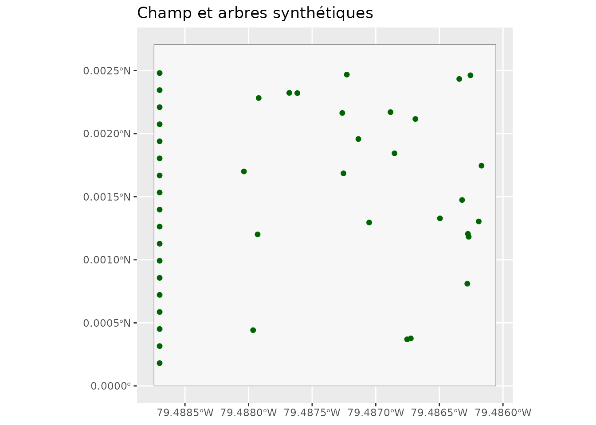
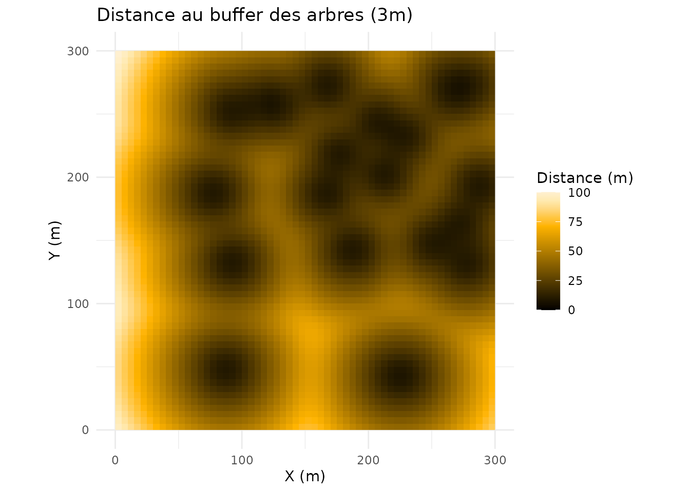
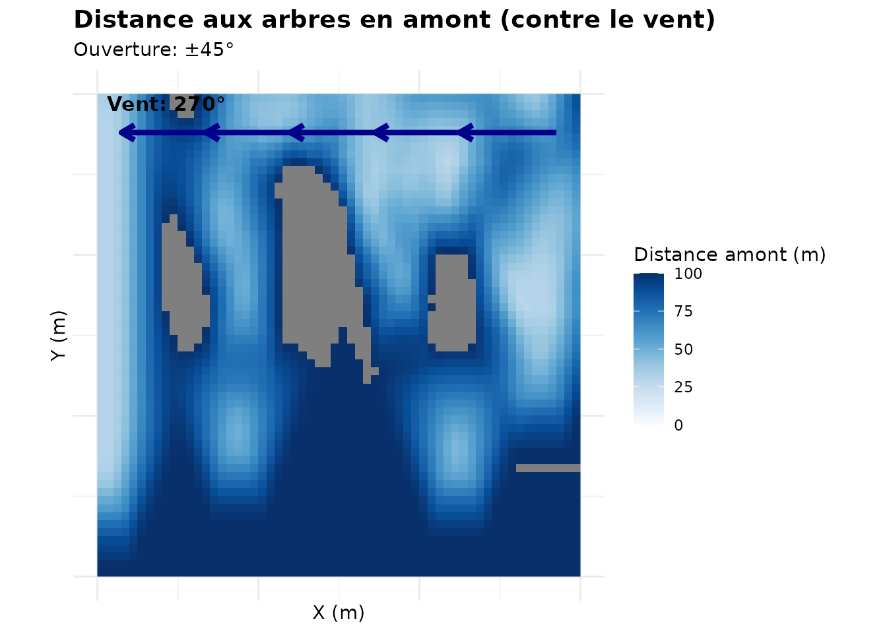
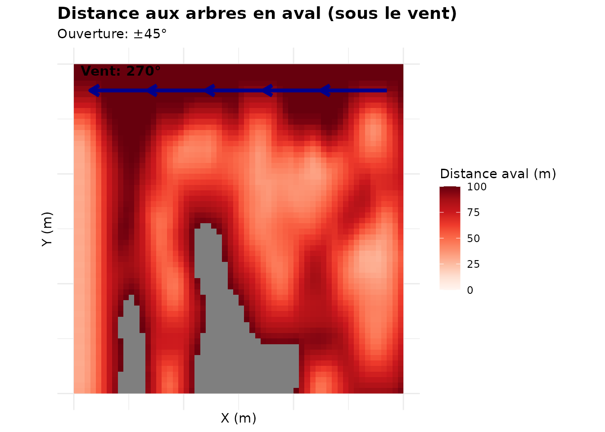
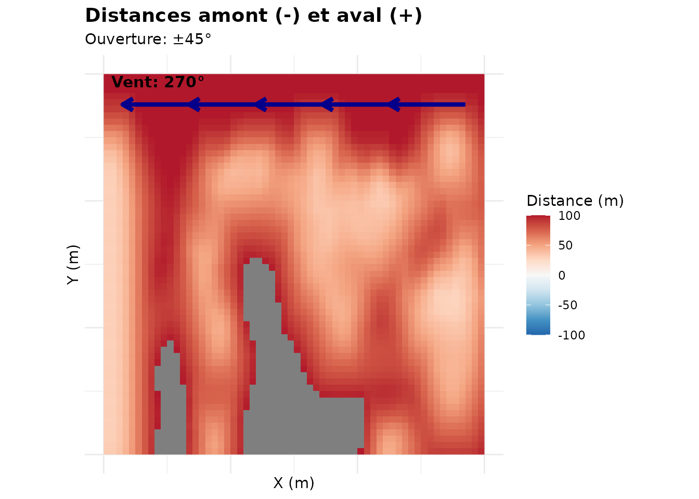
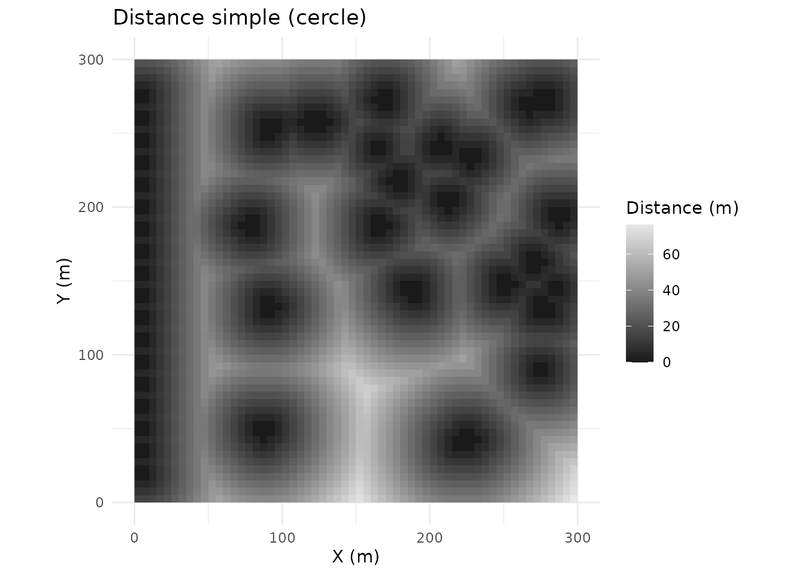
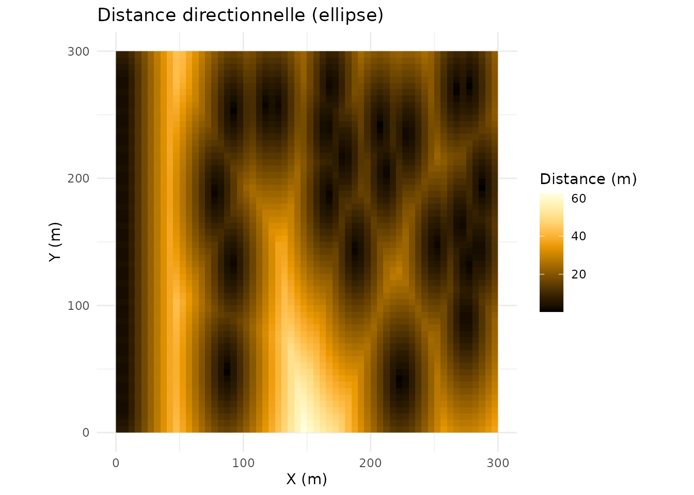
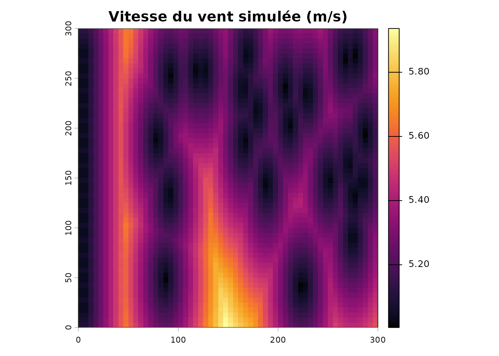
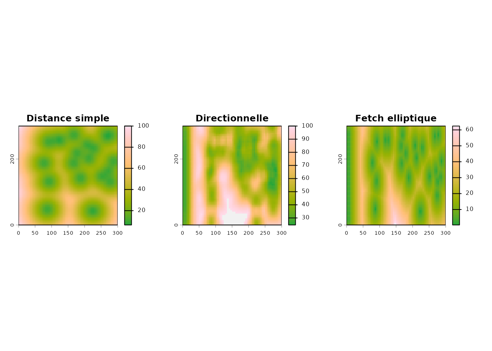

# Distances aux arbres et effet du vent

``` r

library(covariablechamps)
library(sf)
library(terra)
library(ggplot2)
```

## Trois façons de mesurer l’influence des arbres

| Approche | Fonction | Idée |
|----|----|----|
| Distance simple | [`calculer_distance_arbres()`](https://cedricbouffard.github.io/covariablechamps/reference/calculer_distance_arbres.md) | distance euclidienne aux arbres |
| Distance directionnelle | [`calculer_distances_vent()`](https://cedricbouffard.github.io/covariablechamps/reference/calculer_distances_vent.md) | distingue amont (contre le vent) et aval (sous le vent) |
| Fetch elliptique | [`calculer_fetch_vent()`](https://cedricbouffard.github.io/covariablechamps/reference/calculer_fetch_vent.md) | étire la distance dans l’axe du vent |

Pour rester reproductible, on utilise un champ et des arbres
**synthétiques** : une haie sur le bord ouest et quelques arbres isolés.

``` r

champ <- st_as_sf(st_sfc(
  st_polygon(list(matrix(c(0, 0, 300, 0, 300, 300, 0, 300, 0, 0),
                         ncol = 2, byrow = TRUE))),
  crs = 32618))

set.seed(42)
haie   <- data.frame(x = 5, y = seq(20, 280, by = 15))
isoles <- data.frame(x = runif(25, 60, 290), y = runif(25, 40, 280))
arbres <- st_as_sf(rbind(haie, isoles), coords = c("x", "y"), crs = 32618)

ggplot() +
  geom_sf(data = champ, fill = "grey97", colour = "grey50") +
  geom_sf(data = arbres, colour = "darkgreen", size = 1.6) +
  coord_sf() +
  labs(title = "Champ et arbres synthétiques")
```



## Distance simple aux arbres

``` r

d <- calculer_distance_arbres(arbres_sf = arbres, champ_bbox = champ,
                              resolution = 5, buffer_arbre = 3,
                              max_distance = 100)

visualiser_distance_arbres(d, type = "buffer")
```



## Distance directionnelle (amont / aval)

`angle_vent` est donné en degrés (0 = Nord, 90 = Est). Ici, un vent
d’ouest (270°).

``` r

dv <- calculer_distances_vent(arbres_sf = arbres, angle_vent = 270,
                              champ_bbox = champ, resolution = 5,
                              buffer_arbre = 3, angle_focal = 45,
                              max_distance = 100)

tracer_carte_vent(dv, type = "amont")
```



``` r

tracer_carte_vent(dv, type = "aval")
```



`amont` mesure la distance aux arbres situés **du côté d’où vient le
vent** (zone protégée) ; `aval` ceux situés **sous le vent** (zone
exposée).

``` r

tracer_carte_vent(dv, type = "les_deux")
```



## Fetch elliptique

Le fetch étire la distance dans la direction du vent (`coef_ellipse`).

``` r

fetch <- calculer_fetch_vent(arbres_sf = arbres, angle_vent = 270,
                             champ_bbox = champ, resolution = 5,
                             max_fetch = 100, coef_ellipse = 3)

v <- visualiser_fetch(fetch, type = "comparaison")
v$simple
```



``` r

v$elliptique
```



## Vitesse du vent simulée

``` r

vit <- simuler_vitesse_vent_fetch(fetch, vitesse_ref = 5, coef_acceleration = 0.3)

terra::plot(vit$vitesse, main = "Vitesse du vent simulée (m/s)",
            col = hcl.colors(100, "Inferno"))
plot(st_geometry(champ), add = TRUE, border = "grey30")
```



## Comparer les approches

``` r

par(mfrow = c(1, 3), mar = c(2, 2, 3, 2))
terra::plot(d$distance_buffer, main = "Distance simple", col = hcl.colors(100, "Terrain"))
terra::plot(dv$totale,         main = "Directionnelle",   col = hcl.colors(100, "Terrain"))
terra::plot(fetch$distance_elliptique, main = "Fetch elliptique", col = hcl.colors(100, "Terrain"))
```



## À partir du LiDAR

``` r

lidar <- telecharger_lidar_ponctuel(champ, buffer = 100)
arbres <- extraire_classifier_haies_lidar(lidar$nuage_points, hmin = 2)$trees_sf

d  <- calculer_distance_arbres(arbres, champ, resolution = 2)
dv <- calculer_distances_vent(arbres, 270, champ, resolution = 2)
```

## À retenir

- La **distance simple** suffit pour l’ombrage et la distance au
  couvert.
- Les **distances directionnelles** décrivent la protection contre le
  vent.
- Le **fetch elliptique** modélise l’accélération du vent sous le vent.
