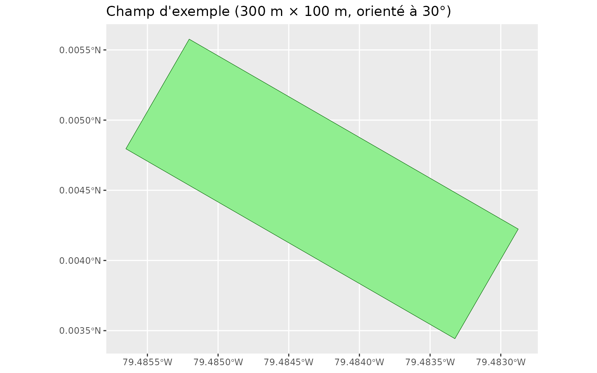
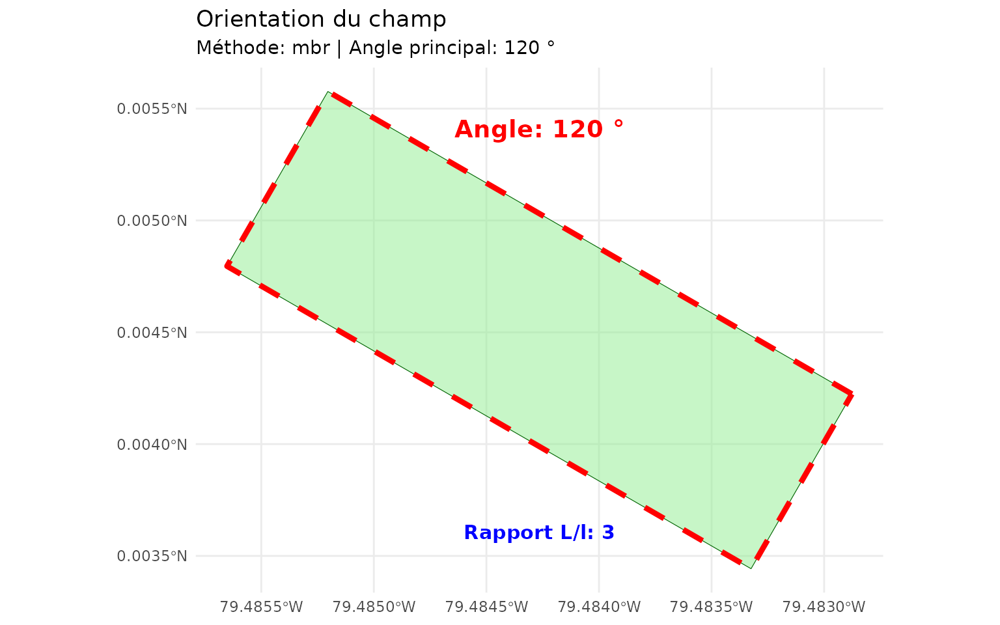
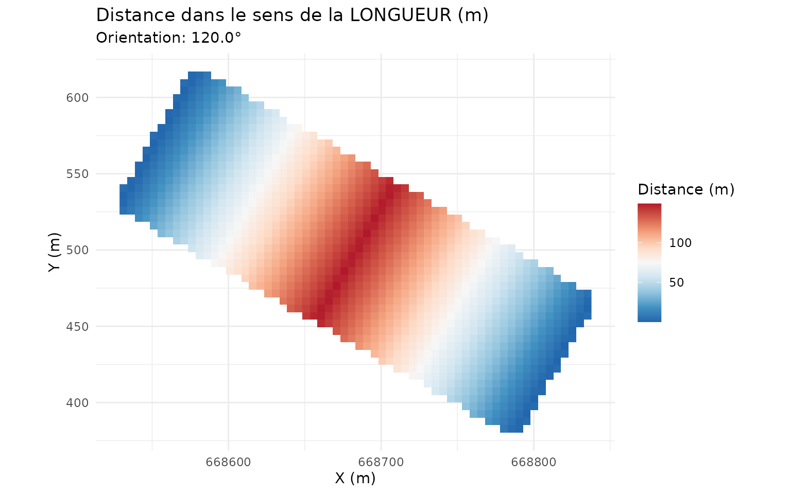
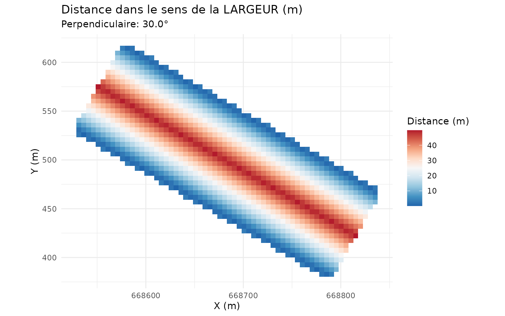
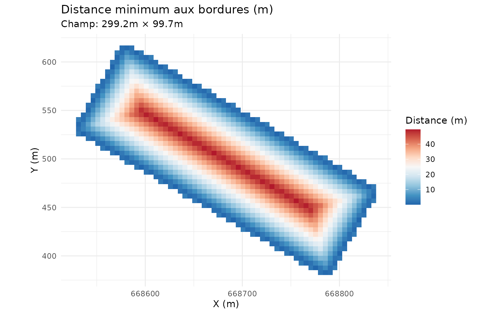
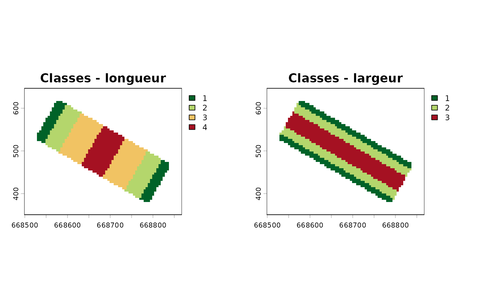
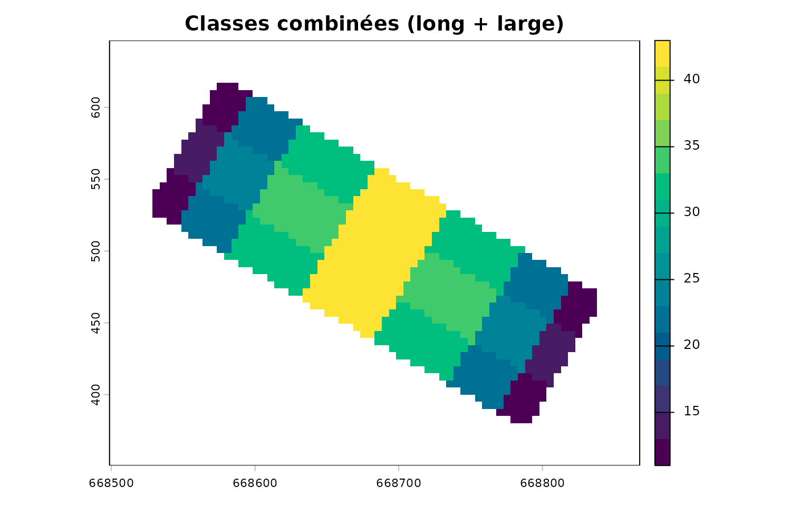
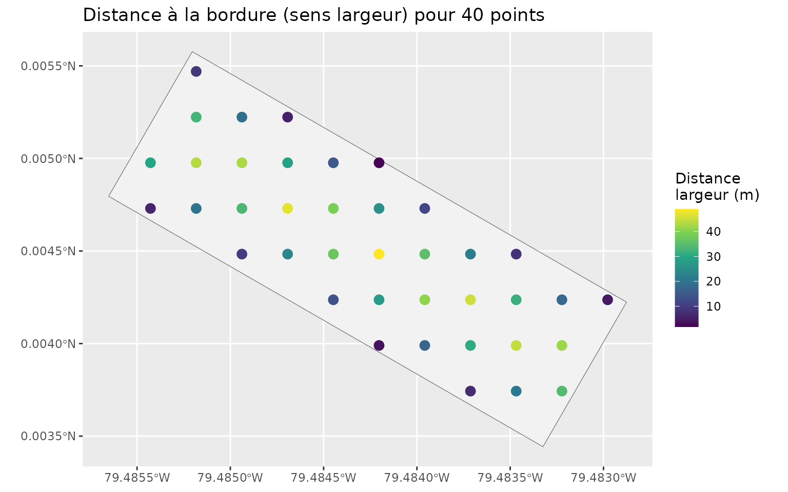

# Distances aux bordures selon l'orientation du champ

``` r

library(covariablechamps)
library(sf)
library(terra)
library(ggplot2)
```

## Pourquoi distinguer longueur et largeur ?

Pour une parcelle allongée, un point peut être « près du bord » dans le
sens de la **largeur** (côté long) tout en étant loin du bord dans le
sens de la **longueur** (extrémité). Distinguer ces deux composantes est
utile pour :

- positionner des haies brise-vent sur les bons côtés ;
- modéliser les gradients de rendement de bordure ;
- identifier les zones d’ombrage et de protection.

## Un champ d’exemple

On construit un rectangle de 300 m × 100 m orienté à 30°.

``` r

angle <- 30 * pi / 180
corners <- matrix(c(-150, -50, 150, -50, 150, 50, -150, 50, -150, -50),
                  ncol = 2, byrow = TRUE)
R <- matrix(c(cos(angle), -sin(angle), sin(angle), cos(angle)), nrow = 2)
corners <- corners %*% t(R) + 500

champ <- st_sf(id = 1, geometry = st_sfc(st_polygon(list(corners)), crs = 32618))

ggplot() +
  geom_sf(data = champ, fill = "lightgreen", colour = "darkgreen") +
  coord_sf() +
  labs(title = "Champ d'exemple (300 m × 100 m, orienté à 30°)")
```



## Orientation du champ

``` r

orientation <- calculer_orientation_champ(champ, methode = "mbr")
orientation[c("angle", "angle_perpendiculaire", "longueur", "largeur",
              "rapport_aspect")]
#> $angle
#> [1] 120
#> 
#> $angle_perpendiculaire
#> [1] 30
#> 
#> $longueur
#> [1] 299.1817
#> 
#> $largeur
#> [1] 99.72942
#> 
#> $rapport_aspect
#> [1] 2.999934

visualiser_orientation(champ, orientation)
```



## Distances longueur / largeur / minimale

``` r

dist <- calculer_distance_bordures_orientee(champ_poly = champ,
                                            resolution = 5, buffer = 30)

plots <- visualiser_distances_bordures(dist, type = "comparaison")
plots$long
```



``` r

plots$large
```



``` r

plots$min
```



- **Longueur** : composante projetée sur l’axe long — faible près des
  extrémités.
- **Largeur** : composante projetée sur l’axe court — faible le long des
  côtés longs.
- **Minimale** : distance euclidienne à la bordure la plus proche.

## Classer les distances

[`classifier_distances_bordures()`](https://cedricbouffard.github.io/covariablechamps/reference/classifier_distances_bordures.md)
découpe chaque composante en classes (bordures, zones tampon, centre)
selon des seuils ajustables.

``` r

classes <- classifier_distances_bordures(
  dist,
  seuils_long  = c(20, 60, 120),
  seuils_large = c(10, 30, 50),
  labels_long  = c("extremite", "proche", "milieu", "centre"),
  labels_large = c("bord", "tampon", "interieur", "centre")
)

par(mfrow = c(1, 2), mar = c(2, 2, 3, 2))
terra::plot(classes$classe_long,  main = "Classes - longueur",
            col = hcl.colors(4, "RdYlGn", rev = TRUE))
terra::plot(classes$classe_large, main = "Classes - largeur",
            col = hcl.colors(4, "RdYlGn", rev = TRUE))
```



La classe combinée encode les deux dimensions en un seul code
(`classe_long × 10 + classe_large`), pratique pour stratifier un
échantillonnage.

``` r

terra::plot(classes$classe_combinee, main = "Classes combinées (long + large)",
            col = hcl.colors(16, "Viridis"))
```



``` r

head(classes$table_classes)
#>   classe_long classe_large code_combine label_long label_large
#> 1           1            1           11  extremite        bord
#> 2           2            1           21     proche        bord
#> 3           3            1           31     milieu        bord
#> 4           4            1           41     centre        bord
#> 5           1            2           12  extremite      tampon
#> 6           2            2           22     proche      tampon
#>        label_combine
#> 1   extremite + bord
#> 2      proche + bord
#> 3      milieu + bord
#> 4      centre + bord
#> 5 extremite + tampon
#> 6    proche + tampon
```

## Points d’échantillonnage

On peut aussi calculer les distances pour des points précis plutôt que
sur une grille.

``` r

pts <- st_sample(champ, size = 40, type = "regular")
pts <- st_as_sf(pts)

res_pts <- calculer_distance_bordures_orientee(points_sf = pts, champ_poly = champ)
res_pts$points
#> Simple feature collection with 39 features and 3 fields
#> Geometry type: POINT
#> Dimension:     XY
#> Bounding box:  xmin: 370.1132 ymin: 415.0096 xmax: 643.604 ymax: 606.4531
#> Projected CRS: WGS 84 / UTM zone 18N
#> First 10 features:
#>                            x distance_min distance_long distance_large
#> 1  POINT (561.5568 415.0096)     7.154977     54.047163       7.154977
#> 2  POINT (588.9058 415.0096)    20.792178     30.426806      20.792178
#> 3  POINT (616.2549 415.0096)     6.806439      6.806439      34.429386
#> 4  POINT (506.8586 442.3586)     3.500926    114.925049       3.500926
#> 5  POINT (534.2077 442.3586)    17.138126     91.304719      17.138126
#> 6  POINT (561.5568 442.3586)    30.775332     67.684379      30.775332
#> 7  POINT (588.9058 442.3586)    44.064029     44.064029      44.412544
#> 8  POINT (616.2549 442.3586)    20.443667     20.443667      41.677370
#> 9  POINT (479.5095 469.7077)    13.484049    146.998178      13.484049
#> 10 POINT (506.8586 469.7077)    27.121254    128.562263      27.121254

ggplot() +
  geom_sf(data = champ, fill = "grey95", colour = "grey40") +
  geom_sf(data = res_pts$points, aes(colour = distance_large), size = 3) +
  scale_colour_viridis_c(name = "Distance\nlargeur (m)") +
  coord_sf() +
  labs(title = "Distance à la bordure (sens largeur) pour 40 points")
```



## Bonnes pratiques

- Travaillez toujours dans un **CRS projeté** (mètres) : les CRS
  géographiques faussent les distances.
- Choisissez des seuils adaptés à l’échelle du champ et à l’effet étudié
  (haie ≈ 10–20 × hauteur ; ombrage selon la latitude).
- Augmentez la résolution (1–2 m) pour un résultat fin, réduisez-la
  (5–10 m) pour explorer rapidement.

## À retenir

| Fonction | Rôle |
|----|----|
| [`calculer_orientation_champ()`](https://cedricbouffard.github.io/covariablechamps/reference/calculer_orientation_champ.md) | Angle et dimensions du champ (MBR ou PCA) |
| [`calculer_distance_bordures_orientee()`](https://cedricbouffard.github.io/covariablechamps/reference/calculer_distance_bordures_orientee.md) | Distances longueur / largeur / minimale |
| [`classifier_distances_bordures()`](https://cedricbouffard.github.io/covariablechamps/reference/classifier_distances_bordures.md) | Classes de distance |
| `visualiser_*()` | Cartes prêtes à l’emploi |
