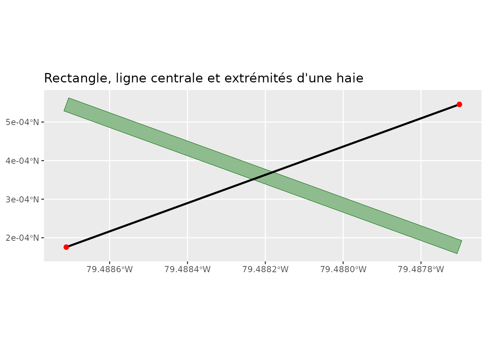
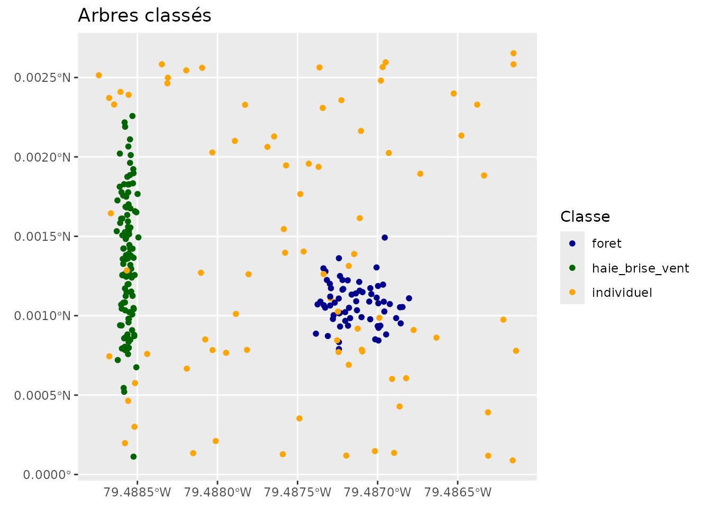
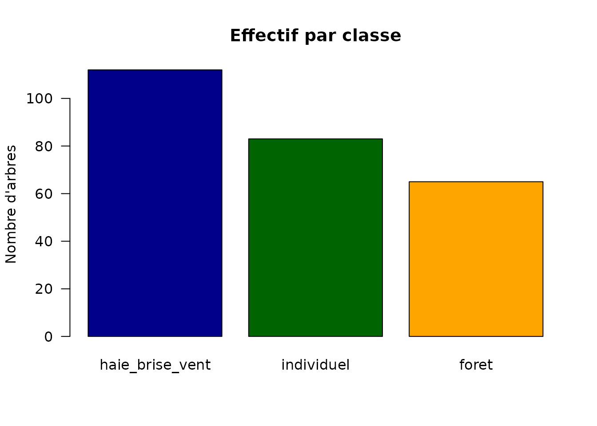

# Détection et analyse des haies brise-vent

``` r

library(covariablechamps)
library(sf)
library(ggplot2)
```

## Du nuage de points à la haie

La détection des haies repose sur le LiDAR : un **DTM** est soustrait
pour normaliser les hauteurs, un **CHM** (modèle de canopée) est
segmenté en arbres, puis un **clustering** (DBSCAN) regroupe les arbres.
Enfin, chaque groupe est classé selon sa forme :

- **haie_brise_vent** : linéaire, allongée (L/W élevé, largeur faible) ;
- **foret** : large, beaucoup d’arbres ;
- **individuel** : arbre isolé.

Ce guide illustre la géométrie produite. Pour le calcul des **zones de
protection** derrière les haies, voir l’article *Zones de protection des
haies brise-vent*.

## Géométrie d’une haie

Une haie est représentée par un **rectangle orienté** (largeur,
longueur, angle) et une **ligne centrale** que l’on peut extraire avec
ses extrémités.

``` r

# Rectangle orienté à 20°, longueur 120 m, largeur 4 m, centré en (60, 40)
ang <- 20 * pi / 180; L <- 120; W <- 4; cx <- 60; cy <- 40
coins <- matrix(c(-L/2, -W/2, L/2, -W/2, L/2, W/2, -L/2, W/2, -L/2, -W/2),
                ncol = 2, byrow = TRUE)
R <- matrix(c(cos(ang), -sin(ang), sin(ang), cos(ang)), nrow = 2)
coins <- coins %*% t(R)
coins[, 1] <- coins[, 1] + cx
coins[, 2] <- coins[, 2] + cy

haie <- st_sf(
  cluster = 1, n_arbres = 40, hauteur_p95 = 15,
  largeur = W, longueur = L, angle_deg = 20,
  x_center = cx, y_center = cy,
  geometry = st_sfc(st_polygon(list(coins)), crs = 32618)
)

lignes <- extraire_ligne_centrale_haies(haie, output_type = "lignes")
extrem <- extraire_ligne_centrale_haies(haie, output_type = "extremites")

ggplot() +
  geom_sf(data = haie,   fill = "darkseagreen", colour = "darkgreen") +
  geom_sf(data = lignes, colour = "black", linewidth = 1) +
  geom_sf(data = extrem, colour = "red", size = 2) +
  coord_sf() +
  labs(title = "Rectangle, ligne centrale et extrémités d'une haie")
```



## Ce que renvoie la classification

Après détection,
[`extraire_classifier_haies_lidar()`](https://cedricbouffard.github.io/covariablechamps/reference/extraire_classifier_haies_lidar.md)
renvoie les arbres avec une colonne `classe`. Voici à quoi ressemble le
résultat (points simulés) :

``` r

set.seed(3)
n <- 260
cl <- sample(c("haie_brise_vent", "foret", "individuel"), n,
             replace = TRUE, prob = c(0.4, 0.25, 0.35))
# positions plausibles selon la classe
x <- ifelse(cl == "haie_brise_vent", 20 + rnorm(n, 0, 3),
     ifelse(cl == "foret", 180 + rnorm(n, 0, 18), runif(n, 0, 300)))
y <- ifelse(cl == "haie_brise_vent", 150 + rnorm(n, 0, 45),
     ifelse(cl == "foret", 120 + rnorm(n, 0, 18), runif(n, 0, 300)))
arbres <- st_as_sf(data.frame(x = x, y = y, classe = cl),
                   coords = c("x", "y"), crs = 32618)

ggplot() +
  geom_sf(data = arbres, aes(colour = classe), size = 1.4) +
  scale_colour_manual(values = c(haie_brise_vent = "darkgreen",
                                 foret = "darkblue",
                                 individuel = "orange")) +
  coord_sf() +
  labs(title = "Arbres classés", colour = "Classe")
```



``` r


barplot(sort(table(arbres$classe), decreasing = TRUE),
        col = c("darkblue", "darkgreen", "orange"), las = 1,
        ylab = "Nombre d'arbres", main = "Effectif par classe")
```



## Pipeline LiDAR réel

``` r

champ <- st_read("mon_champ.shp")

# 1. Télécharger le nuage de points LiDAR
lidar <- telecharger_lidar_ponctuel(champ, buffer = 100)

# 2. Détecter, regrouper et classifier
resultat <- extraire_classifier_haies_lidar(
  nuage_points = lidar$nuage_points,
  res_dtm = 1, res_chm = 0.25, hmin = 2,
  eps_dbscan = 6, minPts_dbscan = 3,
  seuil_aspect = 6, seuil_largeur_max = 12
)

arbres  <- resultat$trees_sf          # arbres + classe
haies   <- resultat$haies_rectangles  # rectangles des haies
```

### Paramètres de détection

| Paramètre                      | Rôle                            | Défaut   |
|--------------------------------|---------------------------------|----------|
| `res_dtm` / `res_chm`          | résolution DTM / CHM (m)        | 1 / 0.25 |
| `hmin`                         | hauteur minimale d’un arbre (m) | 1        |
| `eps_dbscan` / `minPts_dbscan` | regroupement spatial            | 6 / 3    |
| `seuil_aspect`                 | L/W minimal pour une haie       | 6        |
| `seuil_largeur_max`            | largeur max d’une haie (m)      | 12       |

## Bonnes pratiques

- Validez toujours les détections sur le terrain.
- Utilisez une résolution fine (0.25–1 m) pour les haies étroites.
- Privilégiez un LiDAR de saison végétative (feuilles).
- Ajustez `eps_dbscan` et `seuil_aspect` selon la densité d’arbres.

## Suite

Une fois les haies détectées, l’article **Zones de protection des haies
brise-vent** montre comment construire les demi-lunes de protection, les
fusionner et produire un gradient `facteur H`.
