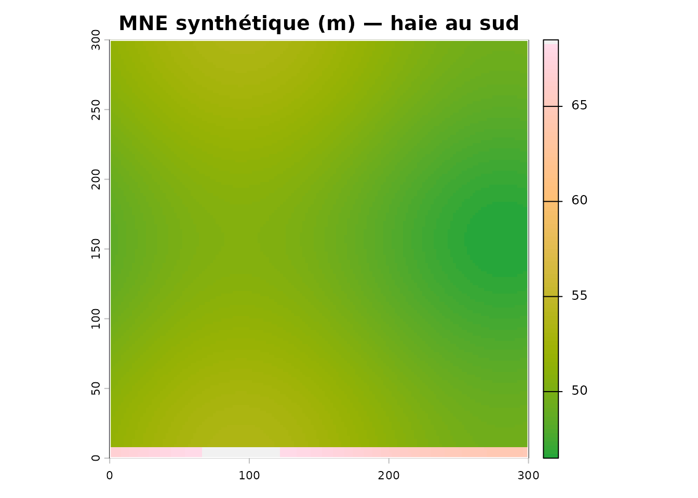
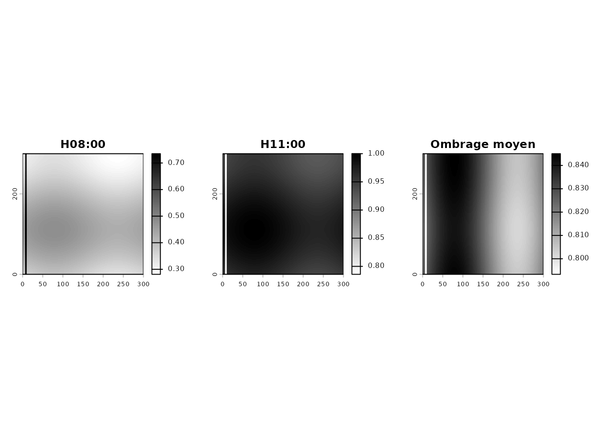
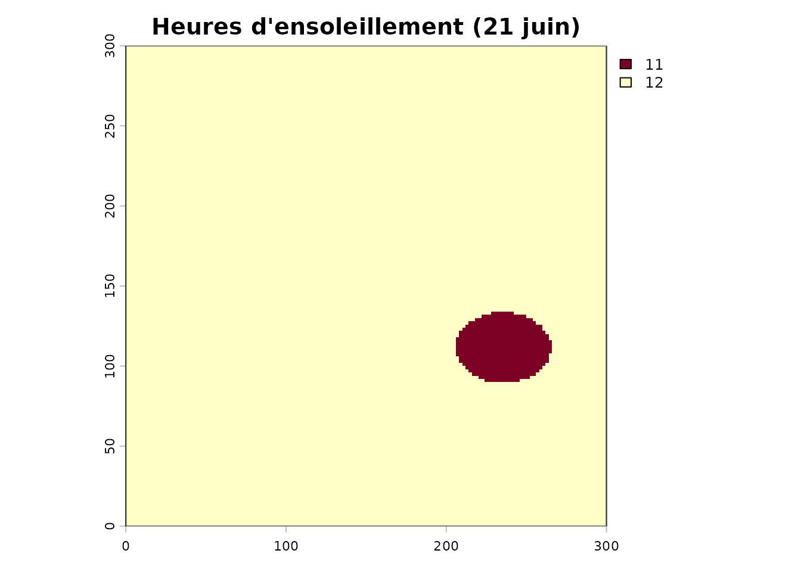
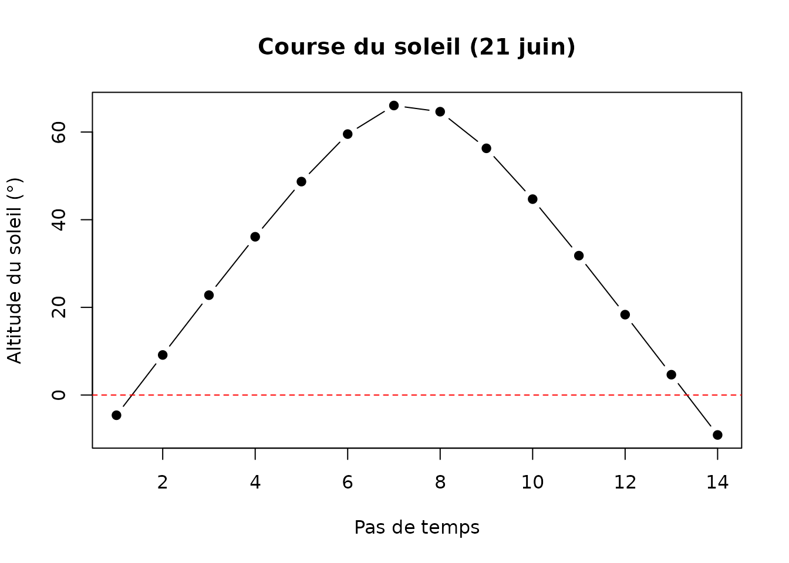
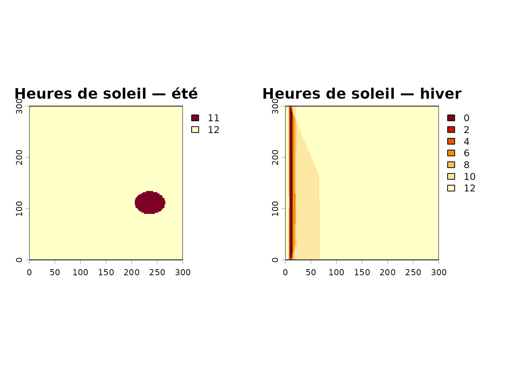
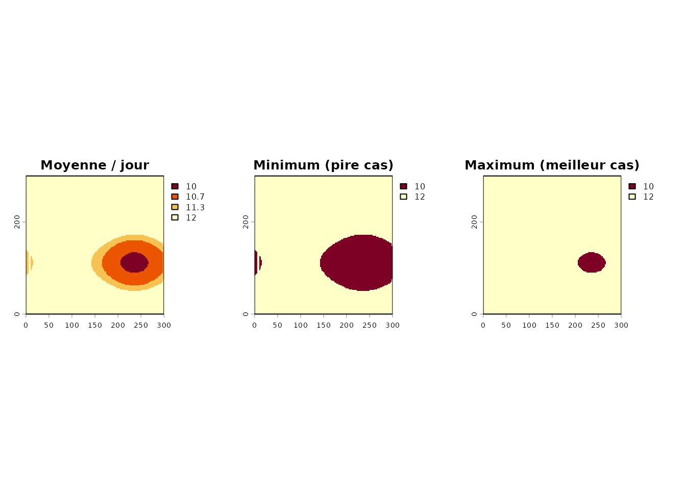
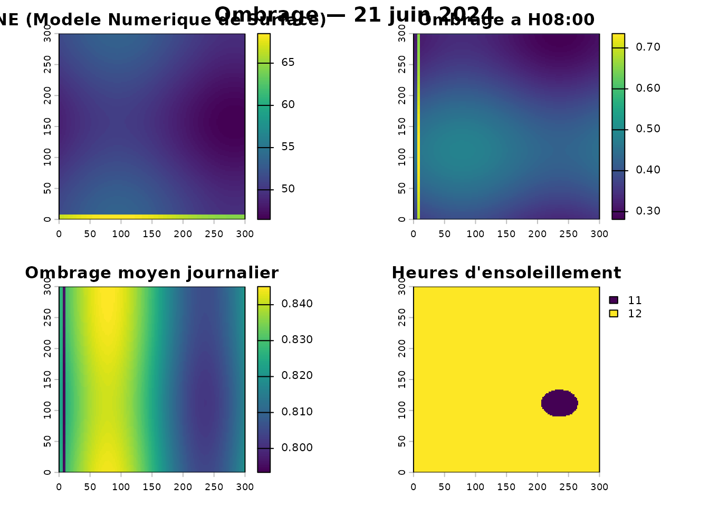

# Calcul de l'ombrage des parcelles

``` r

library(covariablechamps)
library(sf)
library(terra)
```

## Principe

L’ombrage projeté est calculé par **lancer de rayons** (*raycasting*)
sur le Modèle Numérique d’Élévation (MNE), pour chaque position du
soleil de la journée. On obtient, par pixel :

- une **valeur d’ombrage** entre 0 (ombre) et 1 (plein soleil) ;
- le **nombre d’heures d’ensoleillement**.

Pour rester reproductible, on simule un champ de 300 m × 300 m bordé
d’une haie brise-vent au sud, dans un MNE synthétique.

## Un MNE synthétique avec une haie

``` r

mne <- terra::rast(nrows = 150, ncols = 150,
                   xmin = 0, xmax = 300, ymin = 0, ymax = 300,
                   crs = "EPSG:32618")
xy <- terra::xyFromCell(mne, 1:terra::ncell(mne))
terrain <- 50 + 2 * sin(xy[, 1] / 60) + 1.5 * cos(xy[, 2] / 50)
# haie de 15 m le long du bord sud
haie <- ifelse(xy[, 2] < 8, 15, 0)
terra::values(mne) <- terrain + haie
names(mne) <- "MNE"

champ <- st_as_sf(st_sfc(
  st_polygon(list(matrix(c(0, 0, 300, 0, 300, 300, 0, 300, 0, 0),
                         ncol = 2, byrow = TRUE))),
  crs = 32618))

terra::plot(mne, col = hcl.colors(100, "Terrain"),
            main = "MNE synthétique (m) — haie au sud")
plot(st_geometry(champ), add = TRUE, border = "white", lwd = 2)
```



## Ombrage au solstice d’été

`zscale` exagère (ou atténue) la hauteur verticale pour ajuster la
longueur des ombres ; `max_distance` limite la portée du lancer de
rayons.

``` r

ombrage <- calculer_ombrage(
  polygone = champ,
  date = "2024-06-21",
  intervalle_heures = 1,
  mne = mne,
  zscale = 2,
  max_distance = 150
)

par(mfrow = c(1, 3), mar = c(2, 2, 3, 2))
terra::plot(ombrage$ombrage_par_heure[[1]], main = names(ombrage$ombrage_par_heure)[1],
            col = grey(100:0 / 100))
terra::plot(ombrage$ombrage_par_heure[[4]], main = names(ombrage$ombrage_par_heure)[4],
            col = grey(100:0 / 100))
terra::plot(ombrage$ombrage_moyen, main = "Ombrage moyen",
            col = grey(100:0 / 100))
```



## Heures d’ensoleillement

``` r

terra::plot(ombrage$heures_ensoleillement,
            main = "Heures d'ensoleillement (21 juin)",
            col = hcl.colors(100, "YlOrRd"))
plot(st_geometry(champ), add = TRUE, border = "grey40")
```



``` r


# Position du soleil au fil de la journée
info <- ombrage$info_soleil
plot(seq_len(nrow(info)), info$altitude, type = "b", pch = 19,
     xlab = "Pas de temps", ylab = "Altitude du soleil (°)",
     main = "Course du soleil (21 juin)")
abline(h = 0, lty = 2, col = "red")
```



## Été vs hiver

Le même MNE, deux dates : l’ombre est bien plus longue et basse en
hiver.

``` r

hiver <- calculer_ombrage(champ, date = "2024-12-21", intervalle_heures = 2,
                          mne = mne, zscale = 2, max_distance = 150)

par(mfrow = c(1, 2), mar = c(2, 2, 3, 2))
terra::plot(ombrage$heures_ensoleillement, main = "Heures de soleil — été",
            col = hcl.colors(100, "YlOrRd"))
terra::plot(hiver$heures_ensoleillement, main = "Heures de soleil — hiver",
            col = hcl.colors(100, "YlOrRd"))
```



## Sur une période

[`calculer_ombrage_periode()`](https://cedricbouffard.github.io/covariablechamps/reference/calculer_ombrage_periode.md)
agrège plusieurs jours et fournit moyenne, min et max.

``` r

periode <- calculer_ombrage_periode(
  polygone = champ,
  date_debut = "2024-06-01",
  date_fin = "2024-06-30",
  intervalle_jours = 10,
  intervalle_heures = 2,
  mne = mne, zscale = 2, max_distance = 150
)

par(mfrow = c(1, 3), mar = c(2, 2, 3, 2))
terra::plot(periode$heures_ensoleillement_moyen, main = "Moyenne / jour",
            col = hcl.colors(100, "YlOrRd"))
terra::plot(periode$heures_ensoleillement_min, main = "Minimum (pire cas)",
            col = hcl.colors(100, "YlOrRd"))
terra::plot(periode$heures_ensoleillement_max, main = "Maximum (meilleur cas)",
            col = hcl.colors(100, "YlOrRd"))
```



## Vignette de synthèse

``` r

calculer_ombrage_visualisation(ombrage, titre = "Ombrage — 21 juin 2024")
```



## Avec un MNE LiDAR réel

``` r

champ <- st_read("mon_champ.shp")

# calculer_ombrage() télécharge le MNE automatiquement si non fourni
ombrage <- calculer_ombrage(
  polygone = champ,
  date = "2024-06-21",
  intervalle_heures = 1,
  zscale = 1,            # 1 = échelle réelle
  max_distance = 1000
)
```

## À retenir

| Paramètre              | Effet                                          |
|------------------------|------------------------------------------------|
| `date`                 | Position du soleil (azimut, altitude)          |
| `intervalle_heures`    | Pas de temps du calcul                         |
| `zscale`               | Longueur des ombres (exagération verticale)    |
| `max_distance`         | Portée du lancer de rayons                     |
| `seuil_ensoleillement` | Seuil pour compter une heure comme ensoleillée |

Pour un paysage réel, on utilise `telecharger_lidar(mne = TRUE)` afin
d’obtenir un MNE incluant arbres et bâtiments.
