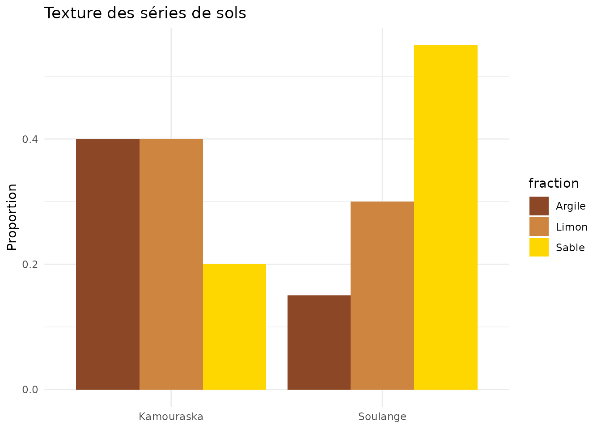
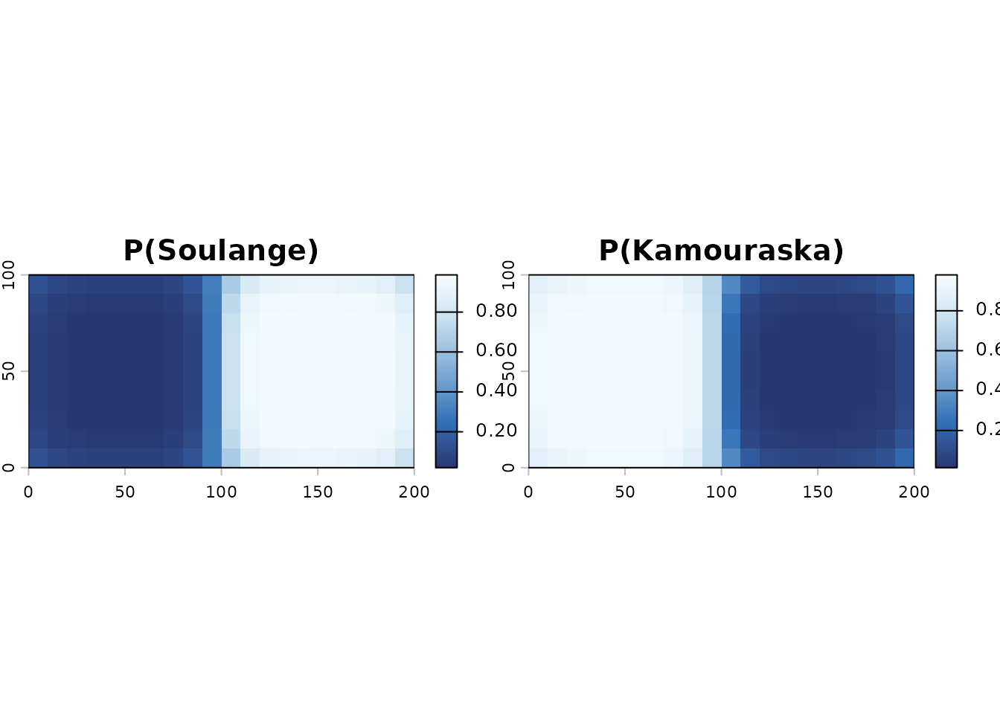
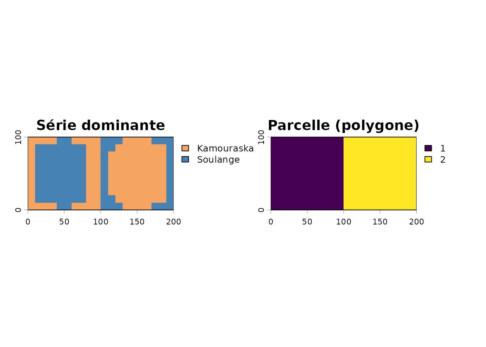
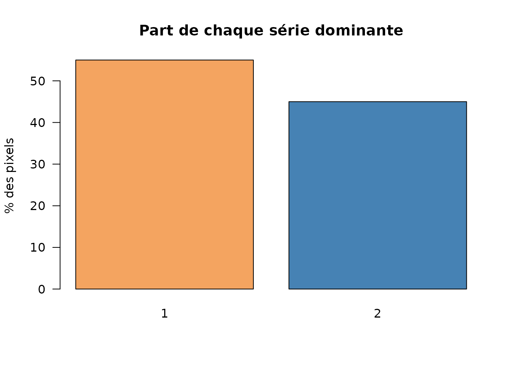

# Pédologie : désagrégation des séries de sols

``` r

library(covariablechamps)
library(sf)
library(terra)
library(ggplot2)
```

## Le problème

La carte pédologique du Québec décrit des **polygones** contenant chacun
un mélange de **séries de sols** (avec un pourcentage et une texture).
Pour l’agriculture de précision, on veut passer de ces polygones à une
carte **au pixel** de la série dominante.

[`proba_et_classement_serie_quota_ilr()`](https://cedricbouffard.github.io/covariablechamps/reference/proba_et_classement_serie_quota_ilr.md)
combine trois sources :

1.  la **texture** de chaque série (sable / limon / argile) ;
2.  le **voisinage** spatial (lissage gaussien) ;
3.  le **MNT** (les sols fins sont plus probables dans les bas de
    pente).

Le classement final respecte les **proportions** (quota) de chaque
polygone, via une comparaison en coordonnées ILR.

## Exemple synthétique

On crée deux parcelles voisines, chacune composée de deux séries, un MNT
en pente douce, et la table des séries.

``` r

p1 <- st_polygon(list(matrix(c(0, 0, 100, 0, 100, 100, 0, 100, 0, 0),
                             ncol = 2, byrow = TRUE)))
p2 <- st_polygon(list(matrix(c(100, 0, 200, 0, 200, 100, 100, 100, 100, 0),
                             ncol = 2, byrow = TRUE)))
polys <- st_sf(Code.polygone = c("A", "B"),
               geometry = st_sfc(p1, p2, crs = 32618))

mnt <- terra::rast(xmin = 0, xmax = 200, ymin = 0, ymax = 100,
                   resolution = 10, crs = "EPSG:32618")
xy <- terra::xyFromCell(mnt, 1:terra::ncell(mnt))
terra::values(mnt) <- 30 + xy[, 1] / 5 + 3 * sin(xy[, 2] / 30)

table_series <- data.frame(
  Code.polygone = c("A", "A", "B", "B"),
  Composante    = c("Soulange", "Kamouraska", "Soulange", "Kamouraska"),
  Pourcentage   = c(60, 40, 30, 70),
  Sable  = c(0.55, 0.20, 0.55, 0.20),
  Limon  = c(0.30, 0.40, 0.30, 0.40),
  Argile = c(0.15, 0.40, 0.15, 0.40)
)
table_series
#>   Code.polygone Composante Pourcentage Sable Limon Argile
#> 1             A   Soulange          60  0.55   0.3   0.15
#> 2             A Kamouraska          40  0.20   0.4   0.40
#> 3             B   Soulange          30  0.55   0.3   0.15
#> 4             B Kamouraska          70  0.20   0.4   0.40

# Composition granulométrique des séries
ser <- unique(table_series[, c("Composante", "Sable", "Limon", "Argile")])
ser_long <- tidyr::pivot_longer(ser, c("Sable", "Limon", "Argile"),
                                names_to = "fraction", values_to = "proportion")
ggplot(ser_long, aes(Composante, proportion, fill = fraction)) +
  geom_col(position = "dodge") +
  scale_fill_manual(values = c(Sable = "gold", Limon = "tan3",
                               Argile = "sienna4")) +
  labs(title = "Texture des séries de sols", x = NULL, y = "Proportion") +
  theme_minimal()
```



## Désagrégation

``` r

res <- proba_et_classement_serie_quota_ilr(
  polygones_sf = polys,
  table_series = table_series,
  mnt = mnt,
  grid_m = 10,
  sigma_voisin = 15,
  verbose = FALSE,
  progress = FALSE
)

# Probabilité d'appartenance à chaque série
terra::plot(res$prob, col = hcl.colors(100, "Blues"),
            main = c("P(Soulange)", "P(Kamouraska)"))
```



``` r

par(mfrow = c(1, 2), mar = c(2, 2, 3, 2))
terra::plot(res$closest_label, main = "Série dominante",
            col = c("sandybrown", "steelblue"))
terra::plot(res$id_r, main = "Parcelle (polygone)")
```



``` r

# Vérifier que les quotas respectent les proportions de la table
tab <- table(terra::values(res$closest_label), useNA = "no")
round(prop.table(tab, margin = NULL) * 100, 1)
#> 
#>  1  2 
#> 55 45

barplot(prop.table(tab) * 100, col = c("sandybrown", "steelblue"),
        ylab = "% des pixels", las = 1,
        main = "Part de chaque série dominante")
```



## Interprétation

- La **série dominante** (`closest_label`) donne la carte finale.
- Les couches `prob` quantifient l’incertitude : une probabilité proche
  de 0,5 signale une transition.
- Le paramètre `alpha_voisin` contrôle l’adhérence spatiale ; `beta_mnt`
  l’influence du relief.

## Données réelles (Québec)

``` r

champ <- st_read("mon_champ.shp")

# 1. Télécharger les polygones pédologiques + la table des séries
#    Source : polygone_pedologie.fgb (jeu de données geoqc)
#    https://storage.googleapis.com/geoqc/Pedologie/polygone_pedologie.fgb
pedo <- telecharger_pedologie_quebec(champ)
polys        <- pedo$polygones        # colonnes : Code.polygone, Appellation.cartographique, ...
table_series <- pedo$table_series     # Code.polygone, Composante, Pourcentage, Sable, Limon, Argile

# 2. Récupérer un MNT LiDAR
mnt <- telecharger_lidar(champ)

# 3. Désagréger
res <- proba_et_classement_serie_quota_ilr(
  polygones_sf = polys,
  table_series = table_series,
  mnt = mnt
)
```

## Paramètres principaux

| Paramètre      | Rôle                                  | Défaut |
|----------------|---------------------------------------|--------|
| `grid_m`       | Résolution de la grille de calcul (m) | 20     |
| `sigma_voisin` | Portée du lissage de voisinage (m)    | 60     |
| `alpha_voisin` | Poids de la similarité de voisinage   | 8      |
| `beta_mnt`     | Poids de l’effet du MNT               | 0.2    |
| `lambda_base`  | Poids de la probabilité de base       | 0.25   |

## À retenir

[`proba_et_classement_serie_quota_ilr()`](https://cedricbouffard.github.io/covariablechamps/reference/proba_et_classement_serie_quota_ilr.md)
transforme des polygones de sols hétérogènes en une carte au pixel
cohérente avec la texture, le voisinage et le relief, tout en respectant
les proportions déclarées.
