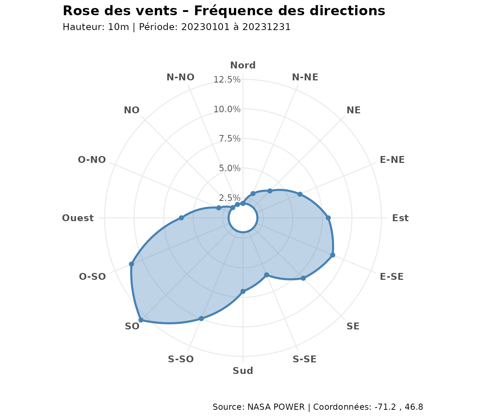
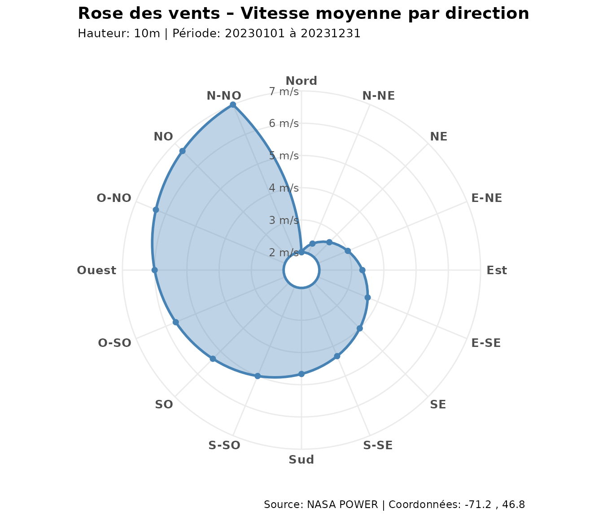
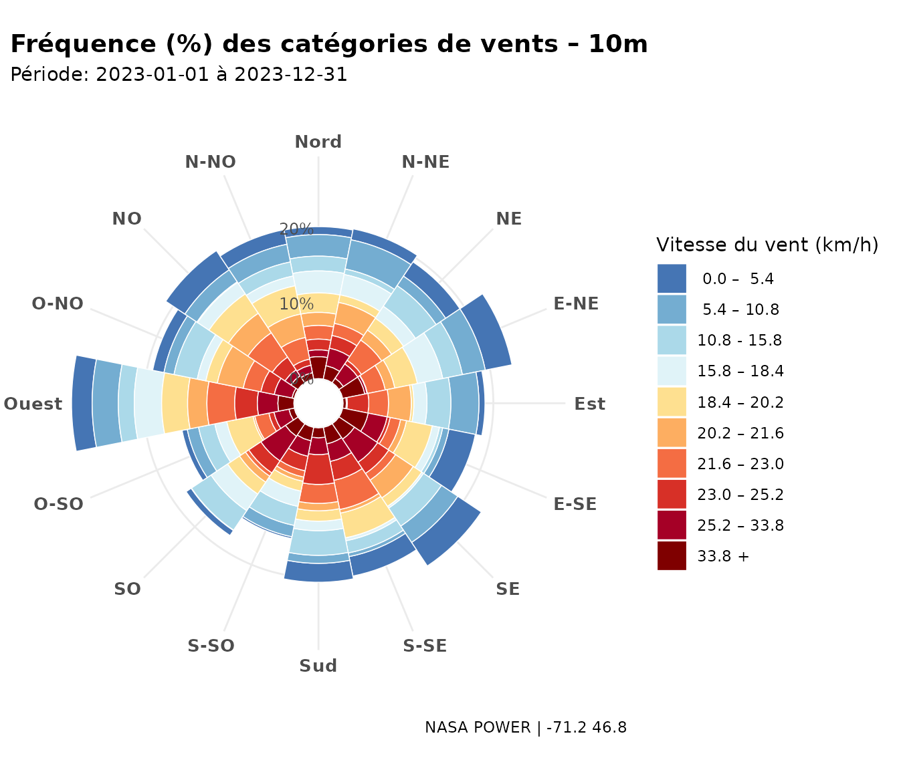
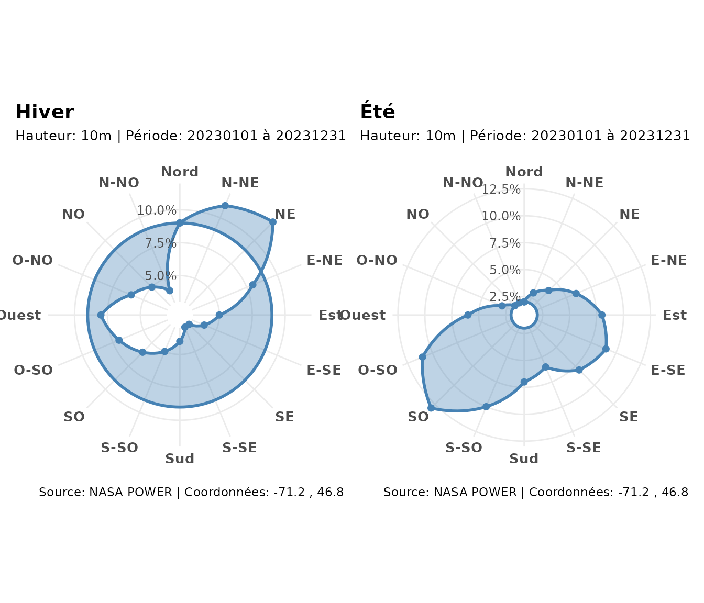
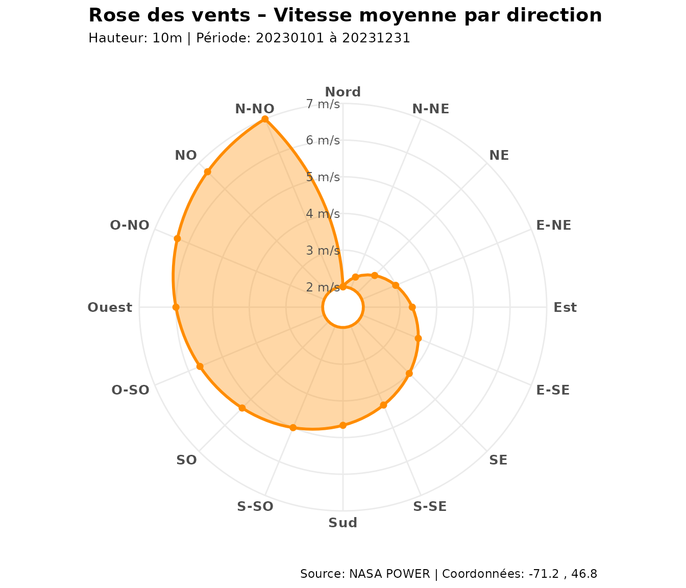

# Analyse du vent et données météorologiques

``` r

library(covariablechamps)
library(ggplot2)
```

## Données de vent

[`obtenir_rose_vents()`](https://cedricbouffard.github.io/covariablechamps/reference/obtenir_rose_vents.md)
interroge l’API **NASA POWER** pour le centroïde d’un champ et renvoie
la distribution des directions et vitesses de vent.

``` r

champ <- sf::st_read("mon_champ.shp")
rose <- obtenir_rose_vents(champ, date_debut = "20230101", date_fin = "20231231")
```

Pour que ce document soit reproductible **sans connexion**, on fabrique
une rose des vents synthétique (mêmes champs que la sortie réelle).

``` r

creer_rose <- function(pct, avg, hauteur = "10m") {
  pct <- pct / sum(pct) * 100
  set.seed(1)
  classes <- matrix(round(runif(16 * 10, 0, 4), 2), nrow = 16,
                    dimnames = list(NULL, paste0("CLASS_", 1:10)))
  list(
    directions = seq(0, 337.5, by = 22.5),
    wd_pct = pct, wd_avg = avg,
    classes = classes,
    coordonnees = c(longitude = -71.2, latitude = 46.8),
    hauteur = hauteur,
    periode = c(debut = "20230101", fin = "20231231"),
    data = list(messages = list(list(CLASSES = NULL)))
  )
}

# Été : vents dominants de sud-ouest
rose_ete <- creer_rose(
  pct = c(2, 3, 4, 6, 8, 9, 8, 6, 7, 10, 13, 11, 6, 3, 2, 2),
  avg = seq(2, 7, length.out = 16)
)
# Hiver : vents dominants de nord-ouest
rose_hiver <- creer_rose(
  pct = c(9, 11, 12, 8, 5, 4, 3, 3, 4, 5, 6, 7, 8, 6, 5, 4),
  avg = seq(3, 9, length.out = 16)
)
```

## Rose des vents — fréquence

``` r

tracer_rose_vents(rose_ete, type = "pct")
```



## Rose des vents — vitesse moyenne

``` r

tracer_rose_vents(rose_ete, type = "avg")
```



## Rose des vents empilée (classes de vitesse)

``` r

tracer_rose_vents_stacked(rose_ete)
```



## Direction dominante

``` r

obtenir_vent_dominant(rose_ete)
#> $angle
#> [1] 225
#> 
#> $label
#> [1] "SO"
#> 
#> $frequence_pct
#> [1] 13
#> 
#> $vitesse_moyenne
#> [1] 5.333333
obtenir_vent_dominant(rose_hiver)
#> $angle
#> [1] 45
#> 
#> $label
#> [1] "NE"
#> 
#> $frequence_pct
#> [1] 12
#> 
#> $vitesse_moyenne
#> [1] 3.8
```

## Comparaison saisonnière

``` r

library(patchwork)
tracer_rose_vents(rose_hiver, type = "pct") +
  ggplot2::labs(title = "Hiver") +
  tracer_rose_vents(rose_ete, type = "pct") +
  ggplot2::labs(title = "Été")
```



## Personnaliser une rose

Les objets renvoyés sont des `ggplot2`, donc entièrement modifiables :

``` r

tracer_rose_vents(rose_ete, type = "avg", palette = "darkorange") +
  ggplot2::theme(legend.position = "none")
```



## Application : orienter une haie

La direction dominante guide l’implantation des haies : on place la haie
**perpendiculaire** au vent dominant.

``` r

dom <- obtenir_vent_dominant(rose_ete)
perp <- (dom$angle + 90) %% 180
data.frame(vent_dominant_deg = dom$angle,
           haie_perpendiculaire_deg = perp,
           frequence_pct = round(dom$frequence_pct, 1),
           vitesse_moy_ms = round(dom$vitesse_moyenne, 2))
#>   vent_dominant_deg haie_perpendiculaire_deg frequence_pct vitesse_moy_ms
#> 1               225                      135            13           5.33
```

## À retenir

| Fonction | Sortie |
|----|----|
| [`obtenir_rose_vents()`](https://cedricbouffard.github.io/covariablechamps/reference/obtenir_rose_vents.md) | Données NASA POWER (16 directions, classes) |
| [`obtenir_vent_dominant()`](https://cedricbouffard.github.io/covariablechamps/reference/obtenir_vent_dominant.md) | Direction la plus fréquente |
| [`tracer_rose_vents()`](https://cedricbouffard.github.io/covariablechamps/reference/tracer_rose_vents.md) | Rose fréquence / vitesse |
| [`tracer_rose_vents_stacked()`](https://cedricbouffard.github.io/covariablechamps/reference/tracer_rose_vents_stacked.md) | Rose empilée par classes de vitesse |

Source des données : [NASA POWER](https://power.larc.nasa.gov/).
