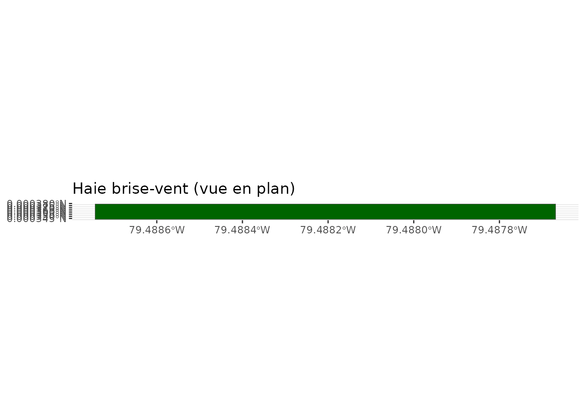
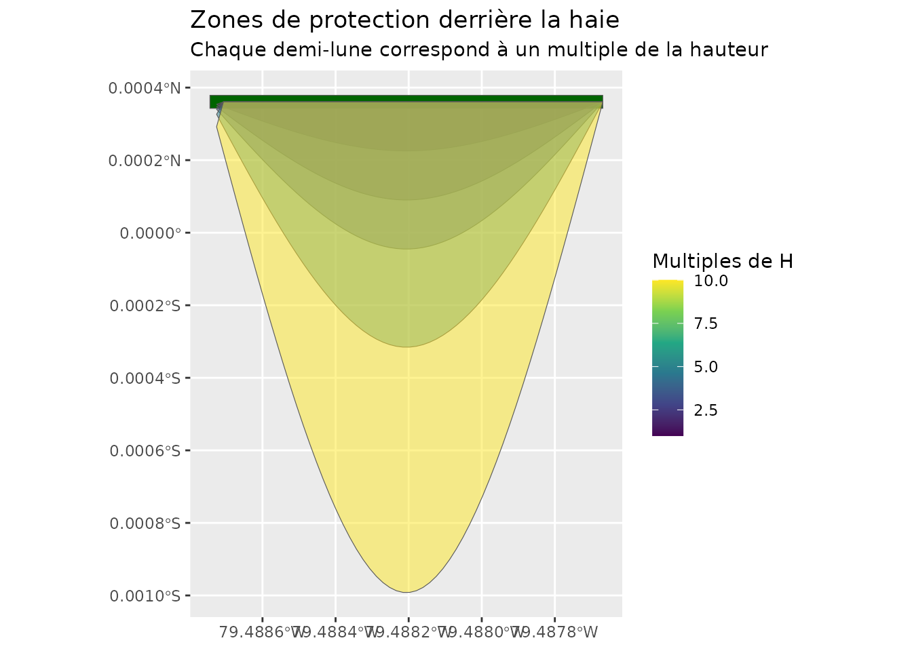
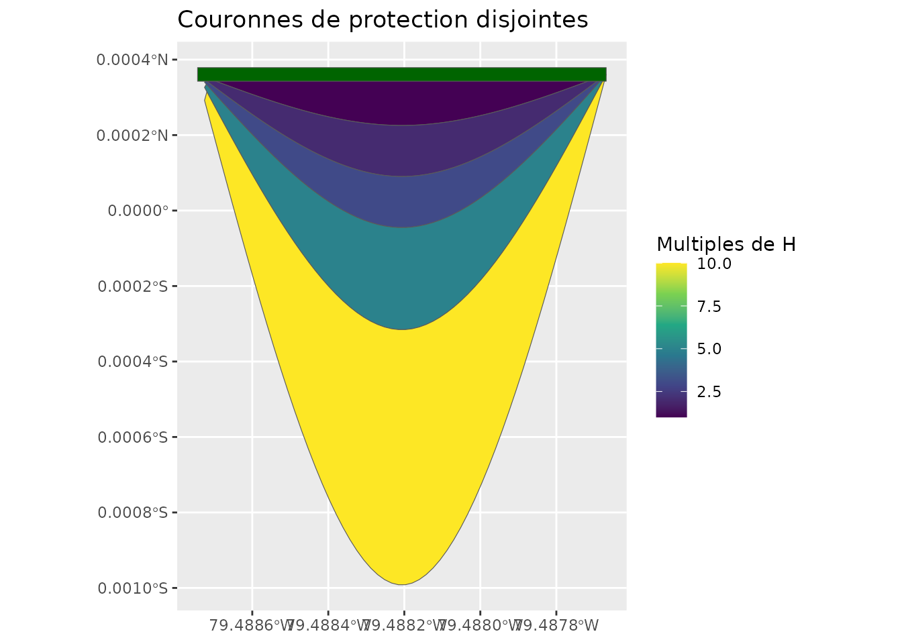
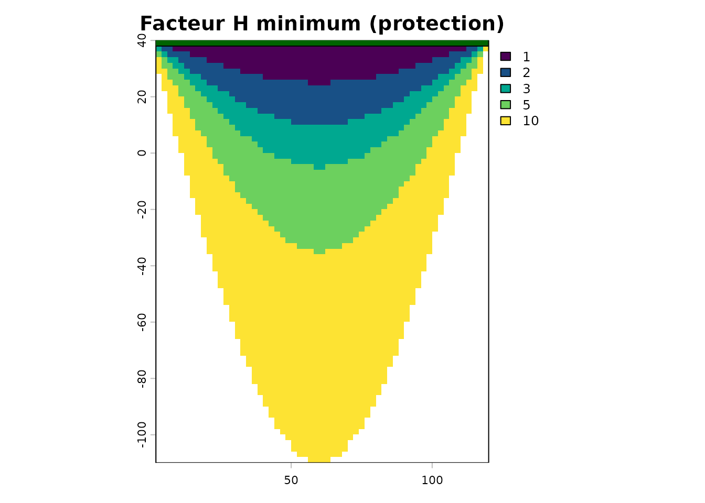

# Zones de protection des haies brise-vent

``` r

library(covariablechamps)
library(sf)
library(terra)
library(ggplot2)
```

## Introduction

Les haies brise-vent protègent les cultures en réduisant la vitesse du
vent sur une distance proportionnelle à leur hauteur `H`. Le package
`covariablechamps` fournit une chaîne d’outils pour :

1.  Construire les **zones de protection** (demi-lunes) derrière chaque
    haie pour plusieurs multiples de la hauteur (`1H`, `2H`, `5H`, …).
2.  **Fusionner** ces zones en couronnes disjointes.
3.  **Rasteriser** un gradient de protection (`facteur H` minimum par
    pixel).

Ce guide utilise une haie synthétique afin d’être entièrement
reproductible, sans téléchargement de données LiDAR.

## Création d’une haie synthétique

Une haie est décrite par un rectangle orienté. La fonction
[`calculer_zones_vent_spline()`](https://cedricbouffard.github.io/covariablechamps/reference/calculer_zones_vent_spline.md)
attend un objet `sf` avec les colonnes `cluster`, `x_center`,
`y_center`, `hauteur_p95`, `largeur`, `longueur`, `angle_deg` et
`n_arbres`.

``` r

haie <- st_sf(
  cluster     = 1,
  n_arbres    = 40,
  hauteur_p95 = 15,
  largeur     = 4,
  longueur    = 120,
  aspect      = 30,
  linearite   = 50,
  angle_deg   = 0,
  x_center    = 60,
  y_center    = 40,
  classe      = "haie_brise_vent",
  geometry    = st_sfc(
    st_polygon(list(matrix(c(
      0, 38, 120, 38, 120, 42, 0, 42, 0, 38
    ), ncol = 2, byrow = TRUE))),
    crs = 32618
  )
)

ggplot() +
  geom_sf(data = haie, fill = "darkgreen") +
  coord_sf() +
  labs(title = "Haie brise-vent (vue en plan)")
```



## Calcul des zones de protection

La `direction_vent` est donnée en degrés (0 = Nord, 90 = Est). Le vent
doit être perpendiculaire à la haie pour obtenir des demi-lunes : ici,
une haie orientée est-ouest et un vent de secteur nord (0°).

``` r

zones <- calculer_zones_vent_spline(
  haies_rectangles = haie,
  direction_vent   = 0,
  facteur_hauteur  = c(1, 2, 3, 5, 10),
  n_points         = 60
)

ggplot() +
  geom_sf(data = haie, fill = "darkgreen") +
  geom_sf(data = zones, aes(fill = facteur_h), alpha = 0.5) +
  scale_fill_viridis_c(name = "Multiples de H") +
  coord_sf() +
  labs(title = "Zones de protection derrière la haie",
       subtitle = "Chaque demi-lune correspond à un multiple de la hauteur")
```



## Fusion et couronnes disjointes

[`fusionner_zones_vent()`](https://cedricbouffard.github.io/covariablechamps/reference/fusionner_zones_vent.md)
fusionne toutes les haies pour un même facteur `H` et rend chaque
couronne disjointe des couronnes plus petites, ce qui évite les
recouvrements.

``` r

couronnes <- fusionner_zones_vent(zones)

ggplot() +
  geom_sf(data = couronnes, aes(fill = facteur_h)) +
  geom_sf(data = haie, fill = "darkgreen") +
  scale_fill_viridis_c(name = "Multiples de H") +
  coord_sf() +
  labs(title = "Couronnes de protection disjointes")
```



## Gradient de protection (facteur H minimum)

[`rasteriser_zones_gradient()`](https://cedricbouffard.github.io/covariablechamps/reference/rasteriser_zones_gradient.md)
convertit les zones en un raster où chaque pixel contient le facteur `H`
**minimum** parmi toutes les zones qui le couvrent. Un pixel couvert par
`1H`, `3H` et `5H` recevra la valeur `1`.

``` r

gradient <- rasteriser_zones_gradient(zones, resolution = 2)

terra::plot(gradient, main = "Facteur H minimum (protection)",
            col = hcl.colors(10, "viridis"))
plot(st_geometry(haie), add = TRUE, col = "darkgreen", border = "black")
```



## Intégration avec les données LiDAR

Dans un flux réel, les rectangles de haies proviennent de la détection
LiDAR avec
[`extraire_classifier_haies_lidar()`](https://cedricbouffard.github.io/covariablechamps/reference/extraire_classifier_haies_lidar.md)
:

``` r

# 1. Télécharger le LiDAR ponctuel autour du champ
lidar <- telecharger_lidar_ponctuel(champ, buffer = 100)

# 2. Détecter et classifier les arbres/haies
arbres <- extraire_classifier_haies_lidar(lidar$nuage_points, hmin = 2)

# 3. Construire les zones à partir des rectangles de haies
zones <- calculer_zones_vent_spline(
  haies_rectangles = arbres$haies_rectangles,
  direction_vent   = 270,
  facteur_hauteur  = 1:20
)

# 4. Fusionner puis rasteriser le gradient de protection
couronnes <- fusionner_zones_vent(zones)
gradient  <- rasteriser_zones_gradient(couronnes, resolution = 2)
```

## Résumé

| Fonction | Rôle |
|----|----|
| [`calculer_zones_vent_spline()`](https://cedricbouffard.github.io/covariablechamps/reference/calculer_zones_vent_spline.md) | Crée les demi-lunes par multiple de `H` |
| [`fusionner_zones_vent()`](https://cedricbouffard.github.io/covariablechamps/reference/fusionner_zones_vent.md) | Fusionne et rend les couronnes disjointes |
| [`rasteriser_zones_gradient()`](https://cedricbouffard.github.io/covariablechamps/reference/rasteriser_zones_gradient.md) | Raster du facteur `H` minimum par pixel |
| [`rasteriser_zones_gradient_v2()`](https://cedricbouffard.github.io/covariablechamps/reference/rasteriser_zones_gradient_v2.md) | Variante équivalente |

## Références

- Heisler, G.M., Dewalle, D.R. (1988). Effects of windbreak structure on
  wind flow. *Agriculture, Ecosystems & Environment*.
- Brandle, J.R., et al. (2004). Windbreaks in North American
  Agricultural Systems. *Agroforestry Systems*.
